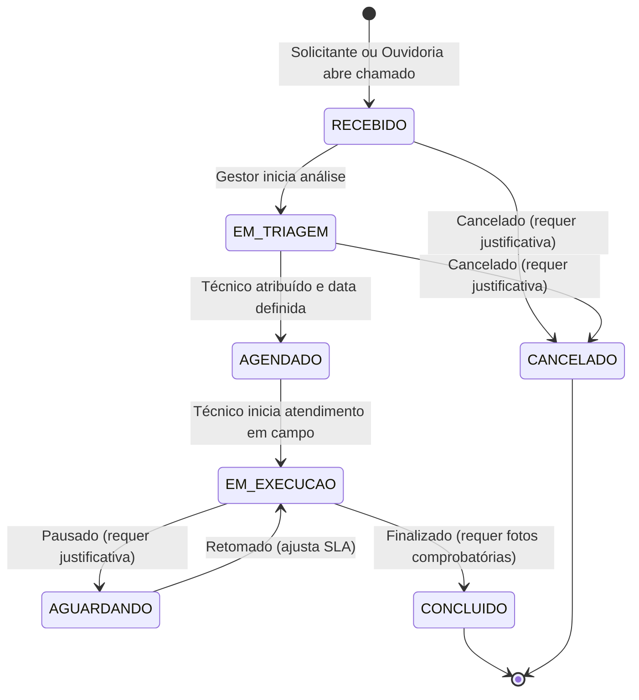

# Regras de Negócio e Fluxos Operacionais (Urboa / Predial)

Este documento centraliza todas as regras de negócio, máquinas de estado, validações legais para Tribunal de Contas (TCE) e fluxos operacionais do sistema.

---

## 1. Multi-Tenancy e Isolamento Municipal

1. **Identificador Municipal Obrigatório**:
   - Toda entidade operacional (`Predio`, `Usuario`, `OrdemServico`, `Manifestacao`, `Material`, `ContratoManutencao`, `AuditoriaLog`) possui a chave estrangeira `prefeitura_id`.
   - As consultas e mutações na API utilizam extensões e guards do Prisma para filtrar compulsoriamente pelo `prefeitura_id` extraído do token JWT do usuário autenticado.
2. **Ativação Modular por Contrato**:
   - A entidade `Prefeitura` possui o array `modulos_ativos`. Se um módulo estiver inativo para o município (ex: `PORTAL_TRANSPARENCIA` ou `COPILOT_IA`), a interface oculta o acesso e a API rejeita as requisições com `403 Forbidden`.

---

## 2. Ciclo de Vida da Ordem de Serviço (OS)

### 2.1. Máquina de Estados Oficial

### 2.2. Regras e Travas de Transição de Estado

| Transição | Quem Pode Executar | Pré-Requisitos e Travas Obrigatórias |
|---|---|---|
| **Abertura ➔ RECEBIDO** | `SOLICITANTE`, `GESTOR`, `ADMIN` | Prédio ativo, título com min 5 caracteres, descrição clara e categoria definida. |
| **RECEBIDO ➔ EM_TRIAGEM** | `GESTOR`, `ADMIN` | Definição da prioridade real e cálculo inicial da `data_limite_sla`. |
| **EM_TRIAGEM ➔ AGENDADO** | `GESTOR`, `ADMIN` | Atribuição obrigatória de um técnico (`tecnico_atribuido_id`). |
| **AGENDADO ➔ EM_EXECUCAO** | `TECNICO`, `GESTOR`, `ADMIN` | Gravação do timestamp `iniciado_em = now()`. |
| **EM_EXECUCAO ➔ AGUARDANDO** | `TECNICO`, `GESTOR`, `ADMIN` | **Trava Obrigatória**: Campo `motivo_pausa` preenchido. Gravação de `pausado_em = now()`. |
| **AGUARDANDO ➔ EM_EXECUCAO** | `TECNICO`, `GESTOR`, `ADMIN` | Cálculo dos minutos decorridos entre `pausado_em` e `now()`, somando em `tempo_pausa_minutos` e adicionando ao histórico de pausas. |
| **EM_EXECUCAO ➔ CONCLUIDO** | `TECNICO`, `GESTOR`, `ADMIN` | **Trava Obrigatória**: Array `fotos_conclusao` deve conter pelo menos 1 evidência fotográfica. Gravação de `concluido_em = now()`. |
| **Qualquer ➔ CANCELADO** | `GESTOR`, `ADMIN` | **Trava Obrigatória**: Campo `motivo_cancelamento` preenchido (exigência do Tribunal de Contas). |

---

## 3. Gestão de Prazos, SLA e Fiscalização do Tribunal de Contas (TCE)

### 3.1. Tabela Padrão de Prazos de Resposta

| Prioridade | SLA Padrão | Cenários Típicos |
|---|---|---|
| **URGENTE** | **4 horas** | Risco iminente à vida, queda de fiação elétrica, falta de água em hospital/UBS, vazamento de gás. |
| **ALTA** | **24 horas** | Sala de aula sem iluminação, bomba d'água inoperante, fechadura externa arrombada. |
| **MEDIA** | **72 horas** | Torneira com gotejamento, trinco quebrado, infiltração superficial, ventilador queimado. |
| **BAIXA** | **168 horas (7 dias)** | Retoques de pintura, reparo de calçada externa, instalação de quadro de avisos. |

### 3.2. Regra de Cálculo do Prazo Fatal
$$\text{data\_limite\_sla} = \text{criado\_em} + \text{SLA\_horas} + \text{tempo\_pausa\_minutos}$$

- **Suspensão Justificada**: O tempo em que a OS permanece com status `AGUARDANDO` (ex: aguardando entrega de peça por fornecedor terceirizado) **não consome** o tempo útil de atendimento (MTTR) do município.
- **Flag de Infração (`sla_violado`)**:
  - Se a data atual ultrapassar `data_limite_sla` antes da conclusão: o sistema marca automaticamente `sla_violado = true`.
  - Para encerrar uma OS com SLA violado, o sistema exige o preenchimento de `motivo_violacao_sla` para alimentar o relatório trimestral de transparência e auditoria.

---

## 4. Gestão Financeira, Contratos Públicos e Controle de Empenhos

Para evitar apontamentos e multas em auditorias do Tribunal de Contas do Estado (TCE), o sistema implementa **travas duras (hard blocks)** de execução orçamentária:

### 4.1. Regras de Contratos de Manutenção
1. **Trava de Vigência Temporal**:
   - Nenhuma Ordem de Serviço pode ser vinculada ou faturada em contrato cuja vigência esteja encerrada (`now() > vigencia_fim`) ou ainda não iniciada (`now() < vigencia_inicio`).
   - A API rejeita a operação com erro `400 Bad Request: CONTRATO_FORA_DA_VIGENCIA`.
2. **Trava de Saldo de Empenho (Hard Block Orçamentário)**:
   $$\text{Saldo Disponível} = \text{valor\_total\_empenhado} - \sum (\text{custo\_total das OSs vinculadas e faturadas})$$
   - Se o valor da nova medição (`custo_materiais + custo_mao_de_obra`) ultrapassar o saldo disponível:
   - A API bloqueia a gravação com o erro: `400 Bad Request: SALDO_CONTRATUAL_INSUFICIENTE`.
3. **Composição de Custos da OS**:
   - $\text{custo\_materiais} = \sum (\text{quantidade} \times \text{preco\_unitario do ItemConsumoOS})$.
   - $\text{custo\_total} = \text{custo\_materiais} + \text{custo\_mao\_de\_obra}$.

---

## 5. Materiais e Controle de Almoxarifado

1. **Tabela de Preços e Catálogo (SINAPI / Municipal)**:
   - Materiais possuem código identificador único (ex: `MAT-ELE-001` ou `SINAPI-1234`), unidade de medida e preço de referência.
2. **Consumo por Ordem de Serviço (`ItemConsumoOS`)**:
   - Cada item utilizado por um técnico no prédio é lançado com a quantidade exata.
   - O estoque (`estoque_atual`) é decrementado automaticamente.
   - Se `estoque_atual < estoque_minimo`, o sistema sinaliza alerta amarelo para reposição no painel de materiais do Gestor.

---

## 6. Ouvidoria Cidadã 156 (Manifestações)

1. **Protocolo Público Rastreável**:
   - Ao registrar uma manifestação, gera-se um protocolo amigável e único: `OUV-XXXXXX`.
2. **Identificação Opcional**:
   - Cidadãos podem optar por registro **Anônimo** (garantido por lei) ou **Identificado** (recebendo notificações por e-mail/SMS).
3. **Conversão de Manifestação em Ordem de Serviço**:
   - Quando a manifestação é aceita pela triagem e requer intervenção física em prédio público, o Gestor aciona o fluxo **Converter em OS**.
   - A nova OS é criada automaticamente associando `manifestacao_origem`.
   - O status da manifestação transiciona para `CONVERTIDA_EM_OS`.
   - Ao concluir a OS no futuro, a resposta oficial da manifestação é pré-preenchida com os dados da manutenção e fotos do antes/depois.

---

## 7. Trilha de Auditoria (AuditoriaLog)

1. **Imutabilidade**:
   - Registros da tabela `auditoria_logs` nunca sofrem `UPDATE` ou `DELETE`.
2. **Eventos Compulsórios**:
   - Toda alteração de perfil de usuário (`Role`), criação/edição de contratos públicos, cancelamento de OS e concessão de saldo orçamentário gera um registro contendo:
     - `usuario_id` do responsável pela ação.
     - `entidade_afetada` e `entidade_id`.
     - `acao`: `CREATE`, `UPDATE`, `DELETE`.
     - `dados_antigos` (JSON do estado anterior).
     - `dados_novos` (JSON do novo estado).
     - `criado_em` (Timestamp preciso do servidor).
