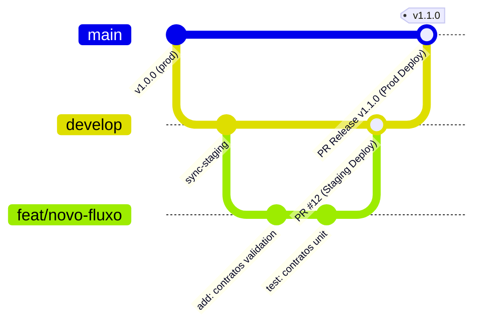

# Fluxo Definitivo de Deploy & Engenharia de Release (Urboa / Predial)

Este documento estabelece a política oficial de versionamento, fluxo de branches, esteira de CI/CD e critérios de promoção entre ambientes (**Localhost ➔ Staging ➔ Produção**).

---

## 1. Princípios Fundamentais

1. **Zero Commits Diretos em `main` e `develop`**:
   - Nenhuma linha de código deve ser enviada diretamente para as branches protegidas (`git push origin main` está proibido).
   - Todo código entra exclusivamente via **Pull Request (PR)** aprovado e testado.
2. **Ambientes Estritamente Isolados**:
   - Cada ambiente possui suas próprias variáveis, banco de dados e URLs de comunicação.
   - Mudanças de banco seguem a esteira: migradas e validadas em Dev ➔ testadas em Staging ➔ implantadas em Prod via `pnpm db:migrate:deploy`.
3. **Imutabilidade e Idempotência**:
   - Deploys são reproduzíveis a partir de hashes de commit específicos.
   - A esteira de migrações é idempotente e executa antes da inicialização do servidor da API.

---

## 2. Topologia de Branches e Ciclo de Vida

Adotamos o modelo **GitFlow Adaptado para SaaS Contínuo**:



### 2.1. Nomenclatura Padrão de Branches

| Padrão | Finalidade | Destino do PR |
|---|---|---|
| `feat/<modulo>-<descricao>` | Implementação de nova funcionalidade | `develop` |
| `fix/<modulo>-<descricao>` | Correção de defeito / bug | `develop` |
| `refactor/<modulo>-<descricao>` | Melhoria estrutural sem alterar comportamento | `develop` |
| `docs/<descricao>` | Atualização de documentação ou TSDoc | `develop` |
| `hotfix/<descricao>` | Correção urgente de emergência em produção | `main` (com cherry-pick/backmerge imediato para `develop`) |

---

## 3. Os Três Ambientes: Matriz Operacional

| Característica | 1. Localhost (Dev) | 2. Staging (Homologação) | 3. Produção (Live) |
|---|---|---|---|
| **Branch Base** | Branch da feature (`feat/*`) | `develop` | `main` |
| **Hospedagem Web** | `localhost:3000` / `localhost:3002` | Vercel Preview / Staging (`staging.uboa.gov.br` ou alias vercel) | Vercel Production (`uboa.vercel.app` ou domínio próprio) |
| **Hospedagem API** | `localhost:3001` / `localhost:3003` | Render Web Service Staging (`urboa-api-staging.onrender.com`) | Render Web Service Prod (`urboa-api.onrender.com`) |
| **Banco de Dados** | Docker Local (PostGIS) | Supabase/Postgres Projeto **Staging** | Supabase/Postgres Projeto **Produção** |
| **Estratégia DB** | `pnpm db:migrate:dev` / `pnpm db:seed` | `pnpm db:migrate:deploy` / `pnpm db:seed:staging` | `pnpm db:migrate:deploy` / `pnpm db:seed:prod` |
| **Usuários & Dados** | Fictícios, resetáveis a qualquer momento | Personas de QA padronizadas com dados realistas | Dados reais de servidores públicos. **Zero mock**. |

---

## 4. O Fluxo Passo a Passo: Do Localhost à Produção

### Fase 1: Desenvolvimento Local (Localhost)
1. Crie a branch a partir da `develop` atualizada:
   ```bash
   git checkout develop
   git pull origin develop
   git checkout -b feat/financials-vigencia-rules
   ```
2. Desenvolva com os serviços locais rodando:
   - Banco local PostGIS via Docker: `docker compose up -d`
   - Migrações locais: `pnpm db:migrate:dev`
   - Servidores de desenvolvimento: `pnpm dev`
3. Valide a qualidade antes de abrir o PR:
   ```bash
   pnpm lint
   pnpm check-types
   pnpm --filter api test
   ```

### Fase 2: Promoção para Staging (Homologação)
1. Faça o commit seguindo o padrão Conventional Commits:
   ```bash
   git commit -m "feat(financials): validar janela de vigencia e travar empenho zerado"
   git push origin feat/financials-vigencia-rules
   ```
2. Abra um Pull Request tendo **`develop`** como branch de destino.
3. O GitHub Actions executa o pipeline de CI (Lint, Typecheck, Testes).
4. Ao realizar o merge para `develop`:
   - O webhook dispara o deploy automático no **Render Staging** (executando `pnpm db:migrate:deploy` no banco de staging).
   - A **Vercel** realiza o build do frontend apontando para o endpoint da API de Staging.
5. **Critério de Aceite em Staging**:
   - A equipe de produto/QA valida o fluxo utilizando as contas da [Matriz de Perfis](file:///docs/USER_PROFILES_MATRIX.md).

### Fase 3: Promoção para Produção (Go-Live)
1. Quando a versão em `develop` for aprovada pelo time:
   - Abra um Pull Request de **`develop` ➔ `main`** com o título: `Release vX.Y.Z: Resumo das Entregas`.
2. O pipeline de CI valida novamente todos os gates na branch `main`.
3. Ao realizar o merge na `main`:
   - A esteira executa `pnpm db:migrate:deploy` no banco de **Produção** com timeout e verificação de saúde.
   - O Render atualiza a API de produção com zero-downtime (rolling update).
   - A Vercel promove o build para a rota canônica de produção.
4. Gera-se uma Tag no Git para rastreabilidade:
   ```bash
   git tag -a v1.1.0 -m "Release v1.1.0 - Modulo Financeiro e Regras de Contratos"
   git push origin v1.1.0
   ```

---

## 5. Regras de Proteção de Branch no GitHub (Modelo Solo Developer)

Como o projeto é mantido por você (desenvolvedor solo), as regras de branch protection devem evitar bloqueios de "aprovação de terceiros" (já que o GitHub não permite que o autor do PR aprove a si mesmo), garantindo que os **Quality Gates automatizados (CI)** sejam o seu guardião de qualidade antes do merge.

Configure as seguintes regras no GitHub (`Settings ➔ Branches ➔ Branch protection rules` para `main` e `develop`):

- [x] **Require a pull request before merging**
  - [ ] **Require approvals**: *Desmarcado* (para permitir que você mesmo aprove e faça o merge do seu PR).
- [x] **Require status checks to pass before merging**
  - [x] **Require branches to be up to date before merging**
  - Status Checks obrigatórios (o GitHub só libera o botão de merge se o CI estiver 100% verde):
    - `Lint, Types & Tests` (executado pelo `.github/workflows/ci.yml`)
- [x] **Do not allow bypassing the above settings** (impede pushes diretos acidentais no terminal)

---

## 5.1. Checklist de Auto-Review Pré-Commit (Solo Developer)

Antes de rodar `git push`, siga o fluxo de revisão em 2 eixos (conforme a skill `.agents/skills/code-review`):

1. **Validação Automática Local**:
   ```bash
   pnpm validate
   ```
2. **Revisão Visual do Diff**:
   ```bash
   git diff --staged
   ```
   - **Eixo Standards**: Sem `console.log` esquecidos, sem emojis em logs do backend NestJS, tipos estritos sem `any`.
   - **Eixo Spec**: Atende exatamente o requisito sem escopo excedente (*scope creep*), transações atômicas com `prisma.$transaction` onde há mutações correlatas.
3. **Commit Semântico e Push**:
   ```bash
   git commit -m "feat(modulo): descricao clara"
   git push origin feat/sua-branch
   ```

---

## 6. Plano de Contingência e Rollback

1. **Falha de Frontend (Next.js / Vercel)**:
   - No painel da Vercel, acesse `Deployments`, localize o deploy anterior estável e clique em `Instant Rollback`. O tráfego é redirecionado em < 5 segundos sem necessidade de rebuild.
2. **Falha de Backend (NestJS / Render)**:
   - No painel do Render, selecione `History` do serviço web da API e reverta para a versão do commit anterior, ou reverta o commit no Git via PR de hotfix.
3. **Falha de Banco de Dados**:
   - As migrações devem ser sempre **aditivas e retrocompatíveis** (Padrão Expand & Contract). Nunca suba migrações que removam ou renomeiem colunas em uso sem um período de depreciação de duas versões.
   - Em caso crítico, restaurar o snapshot PITR (Point-in-Time Recovery) fornecido pelo serviço gerenciado (Supabase/RDS).
